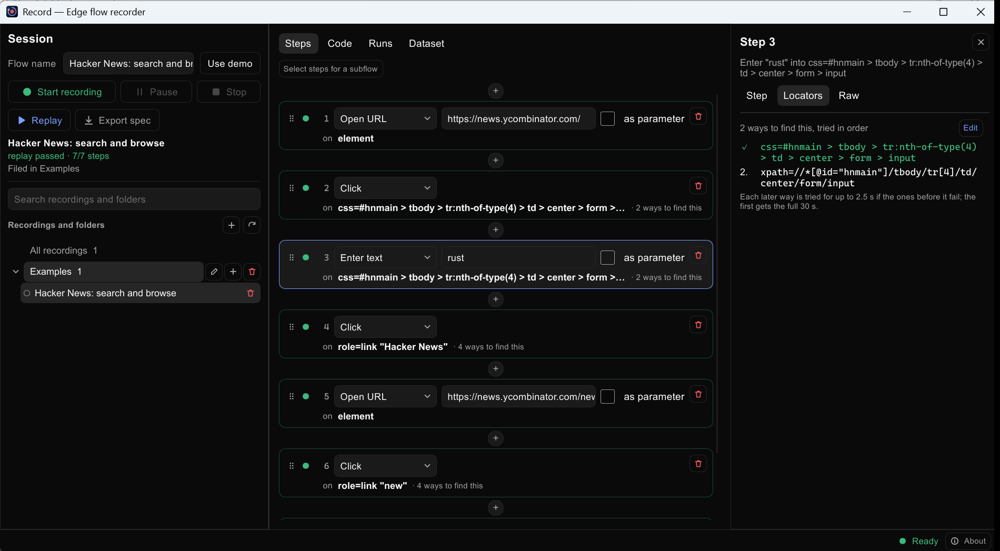

# Record

Record a flow in a real browser, edit it as a list of plain steps, and replay it.
Record drives the Microsoft Edge you already have installed, through
[Playwright](https://playwright.dev), and can export any flow as a Playwright test.



## What it does

- **Record** what you do in Edge: clicks, typing, selects, key presses, file uploads,
  dialogs, and steps inside iframes and shadow DOM.
- **Edit** the result as readable steps ("Enter "rust" into Search"), not code. Change an action or
  value, turn a value into a dataset parameter, reorder by dragging, insert a step by hand or
  by recording just that one step, and save a run of steps as a reusable subflow.
- **Check** what the page shows, not only that the clicks went through: text, field value, URL,
  checkbox state, element count, or that something is hidden. A failing check says what the page
  showed instead.
- **Replay** with a locator ladder: every step stores several ways to find its element and tries
  them in order, so a renamed id doesn't break the flow. Each run keeps its result, timings,
  which locator was used, and a screenshot per step.
- **Export** a flow as a Playwright test (`npx playwright test`).
- **Organise** flows in folders, searchable, in one tree.

Passwords are never stored in plain text: they are encrypted with a per-installation key
(`data/secret.key`) and are left out of exported specs, which read them from environment
variables instead.

## Requirements

- Node.js 20 or later
- Microsoft Edge
- To build the desktop app: a recent Rust toolchain (Windows)

## Quick start

```sh
npm install
npm start                      # the sidecar, on http://127.0.0.1:4317
```

Then run the desktop app (it also starts the sidecar itself if none is running):

```sh
cd record-slint
cargo build --release
./target/release/record-slint
```

Or use it from the command line:

```sh
node cli.js record https://example.com --name "Sign in"
node cli.js replay <sessionId>
node cli.js codegen <sessionId>
```

A small web page is also served at <http://127.0.0.1:4317/>.

## How it fits together

| Part | What it is |
|---|---|
| `src/`, `server/` | The engine: recorder, replayer, locators, exported tests. Node, plain ESM. |
| `record-slint/` | The desktop app, written in Rust with [Slint](https://slint.dev). It talks to the sidecar over local HTTP. |
| `record-gui/` | An earlier desktop app, in Rust with egui. Kept for reference. |
| `web/` | A minimal browser UI, served by the sidecar. |
| `demo/` | Pages the tests run against. |
| `tests/` | The test suite. |

The sidecar only accepts requests from the local machine (it checks the `Host` and `Origin`
headers), and recordings live in `data/`, which is never committed.

Settings, all optional:

| Variable | Effect |
|---|---|
| `PORT` | Sidecar port (default `4317`) |
| `RECORD_DATA_DIR` | Keep recordings, folders and the password key somewhere else |
| `RECORD_HOME` | Where the desktop app finds the project, if it isn't next to the exe |
| `RECORD_NODE` | The `node` the desktop app starts the sidecar with |

## Tests

```sh
npm start             # in one terminal: the tests use the sidecar's demo pages
npm test              # in another: offline and local-demo tests
npm run test:real     # also the tests that need the internet (tests/real-sites)
```

`npm test` runs every file in `tests/` as its own process and reports which, if any, failed.
The real-site tests record and replay public practice sites and can be flaky when a site changes
or shows a consent banner.

## Limits

- Edge only.
- Closed shadow roots and elements that are hidden when recorded can't be targeted.
- The Slint app is built and tested on Windows.

## Status

A proof of concept that has grown past one. It has no license yet.
